<p align="center"></p>

# toybox.os

A personal operating system that runs in the browser. Notes, calendar, tasks, money, habits, a whiteboard and an
optional AI assistant live together in one grayscale, Windows XP–style desktop that also works as a phone app.

It is **local-first**: every device keeps its own full copy of your data and works offline. A small sync server that
you host yourself keeps your devices in step. It runs as a PWA, as a Windows and Linux desktop app and as an Android app.

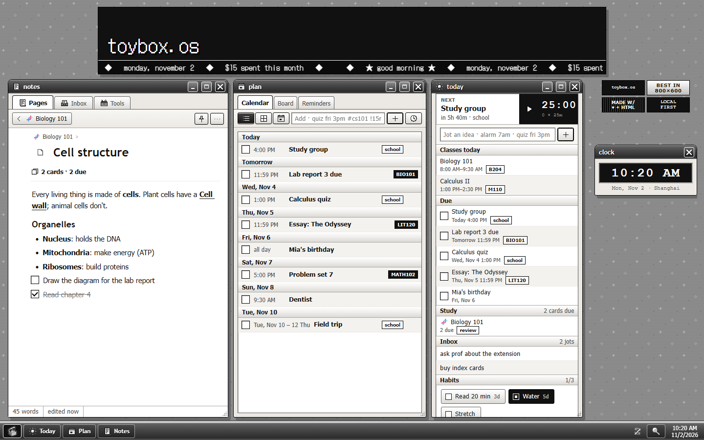

<p align="center">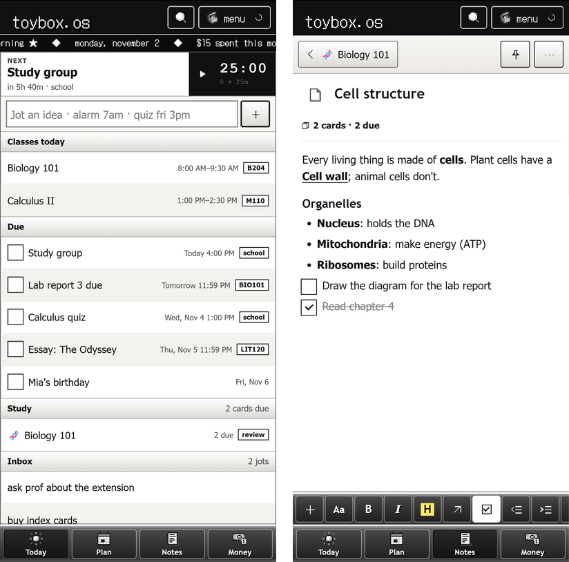</p>

## Features

The app is organised into hubs that make up the taskbar on desktop and the bottom bar on phones.

**Today**: the home screen, with today's classes, deadlines, events, reminders and habits, plus a timer and a
quick-add box.

- **Habits**: daily check-offs and streaks.
- **Timer**: Pomodoro or countdown. On Android it keeps running in a notification after the app is closed.

**Plan**

- **Calendar**: events and deadlines as a list or a month grid, multi-day events, and a weekly class timetable.
- **Board**: a kanban board for tasks, grouped by project.
- **Reminders**: reminders and loud alarms, one-off or repeating, on both phone and desktop.

**Notes**

- **Pages**: a wiki with a block editor, page tree, `[[links]]`, backlinks, flashcards and spaced review. Imported
  PDF, DOCX and EPUB files open in a built-in reader.
- **Inbox**: one-line jots to sort later. Any jot can grow into a page.
- **Draw**: an endless whiteboard with pen pressure, shape snapping, sticky notes and maths that solves itself.
- **Graph**, **Calc** (units, currency and a graphing calculator) and **Links** (bookmarks).

**Money**: income and expenses in two currencies, monthly budgets, subscriptions, loans (owed and owing) and a
wishlist.

### Quick add

Every quick-add box and the command bar share one parser that tolerates typos and any word order. For example,
`remind me to call mom tomorrow 6pm` creates a reminder, `₱250 lunch` logs an expense, and a pasted URL becomes a
link.

### Optional modules

These are off by default. Turn them on in Profile > Modules. The ones marked _server_ also need the sync server to
support them.

| Module         | What it does                                                                                                                                                         |
| -------------- | -------------------------------------------------------------------------------------------------------------------------------------------------------------------- |
| Assistant      | An AI chat ("study buddy") that can read and edit anything in the app, search the web and use your sources. Bring your own provider keys, or run a local model. |
| Change the app | Describe a UI change in plain words. It is built in a sandbox, previewed, and applied only when you press Apply. _server_                                           |
| Jobs           | A daily feed of job listings scored against your profile. _server_                                                                                                   |
| Moodle         | Read-only view of your school's Moodle courses, deadlines and files. _server_                                                                                        |
| Home server    | Terminal, file manager and service status for the machine running the server. _server_                                                                               |

### Look and feel

The whole look comes from a **pack**: art, colours, fonts, wallpaper, mascot and badges. The Theme editor changes any
of it from inside the app, including the app icon on the taskbar, tray and browser tab (Art > App icon). Only the neutral `default` pack ships in this repository (see [Art packs](#art-packs)).

## Looks

Pick a pack from the Pack store (Start > Appearance > Pack store) and the art, colours, fonts, wallpaper, mascot,
badges and icons change in one go. Moss, Night shift and Peach paper are original and CC0; the rest are fan packs
that credit their artists.

<table>
<tr><td align="center">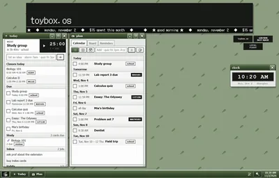<br><sub>Moss</sub></td><td align="center">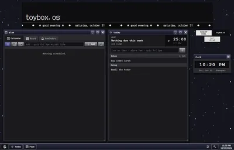<br><sub>Night shift</sub></td><td align="center">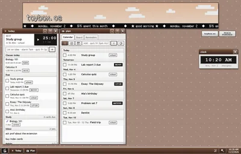<br><sub>Peach paper</sub></td></tr>
<tr><td align="center">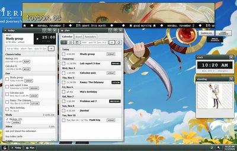<br><sub>Frieren</sub></td><td align="center">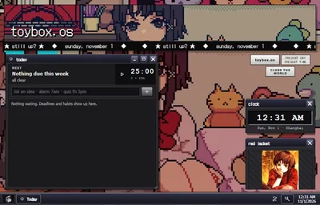<br><sub>Lain</sub></td><td align="center">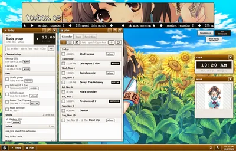<br><sub>Haruhi</sub></td></tr>
<tr><td align="center">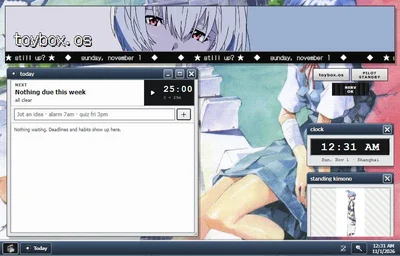<br><sub>Rei</sub></td><td align="center">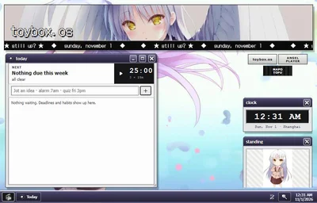<br><sub>Kanade</sub></td><td align="center">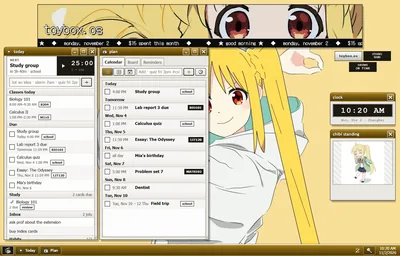<br><sub>Nijika</sub></td></tr>
<tr><td align="center">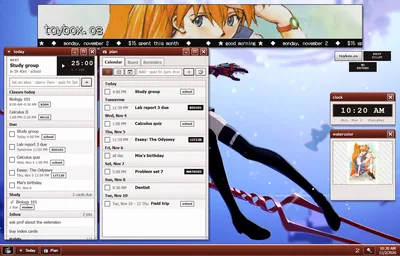<br><sub>Asuka</sub></td><td align="center">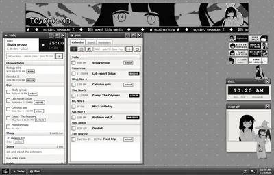<br><sub>Osage-chan</sub></td></tr>
</table>

Or keep it simple: 11 built-in skins (the swatches at the bottom of the Start menu), and the Theme editor makes your own from one colour.

<table>
<tr><td align="center">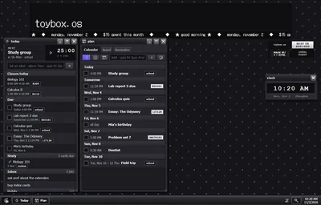<br><sub>Night</sub></td><td align="center">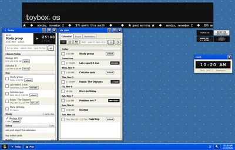<br><sub>Luna</sub></td><td align="center">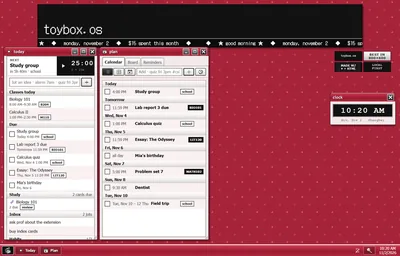<br><sub>Cherry</sub></td><td align="center">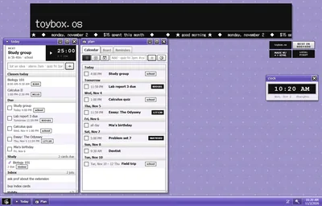<br><sub>Lilac</sub></td></tr>
<tr><td align="center">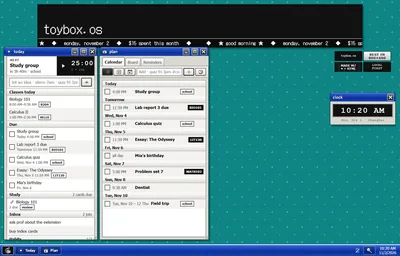<br><sub>Teal</sub></td><td align="center">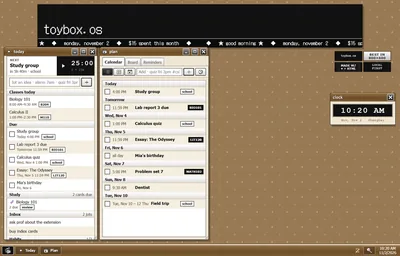<br><sub>Sepia</sub></td><td align="center">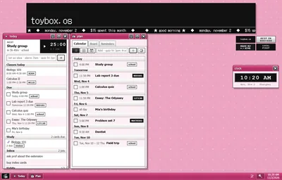<br><sub>Bubblegum</sub></td><td align="center">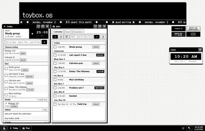<br><sub>Paper</sub></td></tr>
</table>

## How it works

- Every change is saved on the device first, so nothing waits on the network.
- When sync is on, the device sends its changes to the server every 20 seconds and on every edit. Each document is
  kept if it is newer (last write wins), and deletes travel as tombstones.
- The server is a single Python file using only the standard library, with everything stored in one SQLite
  database.
- AI keys stay on the server and are never sent back to the app. Long assistant chats run on the server, so they
  finish even after you close the app.
- New versions are published as [releases](https://github.com/auroraongithub/toyboxos/releases). Servers update
  themselves from the latest one, and installed apps update from their server.

[`docs/toybox-map.html`](docs/toybox-map.html) has diagrams of every window and server piece and where each one
lives in the code.

## Getting started

### Install the app

Everything is in the [latest release](https://github.com/auroraongithub/toyboxos/releases/latest). On one device you
can stop after installing: the app works fully offline. To keep several devices in step, run a sync server (step 1
below).

**Windows.** Download `toybox.os_<version>_x64-setup.exe` and run it. It installs for your user only, no admin
needed. Windows may warn that the publisher is unknown, because the installer isn't code-signed: choose More info >
Run anyway.

**Linux.** Pick the file for your distro and processor: `amd64`/`x86_64` for most PCs, `arm64`/`aarch64` for a
Raspberry Pi or other ARM machines. It needs glibc 2.35 or newer (Ubuntu 22.04, Debian 12, Fedora 36 or later).

- Debian, Ubuntu, Mint, Pop!_OS:

  ```sh
  sudo apt install ./toybox.os_*_amd64.deb
  ```

- Fedora, openSUSE, RHEL:

  ```sh
  sudo dnf install ./toybox.os-*.x86_64.rpm
  ```

- Any other distro (Arch, NixOS, Steam Deck...): the AppImage runs without installing.

  ```sh
  chmod +x toybox.os_*_amd64.AppImage
  ./toybox.os_*_amd64.AppImage
  ```

  If it says FUSE is missing, install `libfuse2` (Ubuntu 24.04: `libfuse2t64`). The AppImage adds no menu entry on
  its own; [Gear Lever](https://flathub.org/apps/it.mijorus.gearlever) or AppImageLauncher can add one.

The `.deb` and `.rpm` add toybox.os to your app menu. Closing the window keeps it in the tray so reminders still ring;
on GNOME the tray needs the "AppIndicator and KStatusNotifierItem Support" extension (Ubuntu has it on already).
Tray > Quit really quits. To have reminders from the moment you log in, add toybox.os to your desktop's startup apps.

**Android.** Download `toybox-os-android-arm64.apk` and open it. Allow installs from your browser or file manager
when asked.

**iPhone, iPad, macOS and anything else.** There's no download: once a sync server is running, open it in the
browser and install it from there (Safari: Share > Add to Home Screen / Add to Dock; Chrome and Edge: Install app in
the address bar). Phones need the server on HTTPS for this (see step 2).

The release also has `toybox-server-windows.exe`, `toybox-server-linux-x64` and `toybox-server-linux-arm64`: the sync
server on its own, for a computer that stays on.

### 1. Run the sync server

The simplest: in the Windows or Linux app, Start > Sync > tick **Host sync on this computer**. It runs while the app
is open or in the tray, and **Pair a device** shows a code and QR for your other devices. On Linux with a firewall
on, let the other devices in with `sudo ufw allow 8787/tcp` (Fedora: `sudo firewall-cmd --add-port=8787/tcp
--permanent && sudo firewall-cmd --reload`).

For a computer that stays on, run a server program from the release instead (Linux: `chmod +x
toybox-server-linux-*` once, then run it). On macOS or a NAS, Docker is the quickest:

```sh
docker compose up -d
docker compose exec toybox python3 server.py pair
```

The first command builds the app and starts the server on port 8787. The second prints a one-time pairing code. Your
data is stored in `./toybox-data`.

Other options:

- a Linux or macOS service via `bash server/install.sh`
- a standalone program for Windows or Linux (in the release)
- hosting from inside the Windows or Linux desktop app

All of these are covered in [`server/README.md`](server/README.md), along with HTTPS, using the server away from home,
and backups.

On a Linux server, `bash server/install.sh --admin` also sets up the Home server window (terminal, files, services)
for your own Tailscale network; see [Home server window](server/README.md#home-server-window-optional).

### 2. Connect your devices

In the Windows, Linux or Android app: Start > Sync, enter the server address (`http://<server>:8787`) and the
pairing code. In a browser, open `http://<server>:8787` and enter the code when Setup asks for it. To add more
devices, get a new code from Start > Sync > Pair another device.

Without a download (iPhone, iPad, macOS), the browser can install the app
only when the server is reached over HTTPS: [Tailscale Funnel](https://tailscale.com/kb/1223/funnel) or a reverse
proxy such as Caddy gives you that, and it also lets your devices sync away from home.

## Development

You need Node 18+ and Python 3.9+.

```sh
npm install
npm run build        # builds the PWA into dist/
```

Serve `dist/` from the sync server or any static host. To use a pack other than `default`, set `SOS_PACK=<name>`
when you build.

### Tests and linting

```sh
npm test                                              # unit tests (Node)
python -m unittest discover -s server -p "test_*.py"  # server tests
npm run lint                                          # Prettier + ruff (pip install ruff)
npm run format
```

The browser tests drive the built app in desktop and phone sizes with Playwright. Run `npm run build` first, and set
up Playwright once:

```sh
pip install playwright && python -m playwright install chromium
npm run test:ui
```

### Native apps

`src-tauri` holds the [Tauri 2](https://tauri.app) shells for Windows and Linux (tray icon, title bar, built-in server) and
Android (alarms, timer notification). The app itself is the same web build, so most updates reach installed apps
without a new installer.

```sh
npx tauri build          # Windows installer, or .deb/.rpm/AppImage on Linux
npx tauri android build  # Android APK
```

Linux builds need `libwebkit2gtk-4.1-dev libayatana-appindicator3-dev librsvg2-dev libxdo-dev libssl-dev` (Debian
names) and PyInstaller for the built-in server. CI builds them in `.github/workflows/linux-app.yml`.

### Releases

Every push to `main` that changes the app publishes an update release (`.github/workflows/release.yml`): the update
zip and `latest.json` that servers install from, with the installers carried over from the release before. A change to
the native shells (`src-tauri`) rebuilds the Linux app automatically (`linux-app.yml`); the Windows installer and APK
are built and attached by hand.

### Project layout

| Path           | Contents                                                       |
| -------------- | -------------------------------------------------------------- |
| `src/core`     | Data store, sync, dates, money, the quick-add parser, AI calls |
| `src/ui`       | The XP-style UI kit (windows, tabs, panels)                    |
| `src/modules`  | One file per window, plus the module registry                  |
| `src/shell`    | Window manager, taskbar, Start menu, themes                    |
| `src/styles`   | CSS                                                            |
| `src/packs`    | Art packs (only `default` is committed)                        |
| `server`       | Sync server, AI proxy, background jobs and their tests         |
| `src-tauri`    | Windows and Android shells                                     |
| `tests`        | Node unit tests and Playwright browser tests (`tests/ui`)      |
| `docs`         | The architecture map                                           |
| `vendor`       | Bundled third-party code (Preact, htm, PDF.js, xterm)          |

## Art packs

Packs live in `src/packs/<name>/`. Everything except `default` is gitignored, so character art that isn't yours to
publish stays private. To make your own, copy `src/packs/default`, then build with `SOS_PACK=<name> npm run build`.
You can also load pack files, or save your current look as one, in Theme editor > Packs. Packs saved there
sync to your other devices.

## More documentation

- [`server/README.md`](server/README.md): installing, updating, pairing, HTTPS, settings and backups
- [`server/PROVIDERS.md`](server/PROVIDERS.md): AI providers, models and keys
- [`server/INGEST.md`](server/INGEST.md): feeding jobs, jots, links and events in from other programs
- [`server/MOODLE.md`](server/MOODLE.md): connecting a Moodle account
- [`docs/toybox-map.html`](docs/toybox-map.html): architecture map

## License

ISC, see [LICENSE](LICENSE). Vendored libraries keep their own licenses ([vendor/THIRD_PARTY.md](vendor/THIRD_PARTY.md)).
